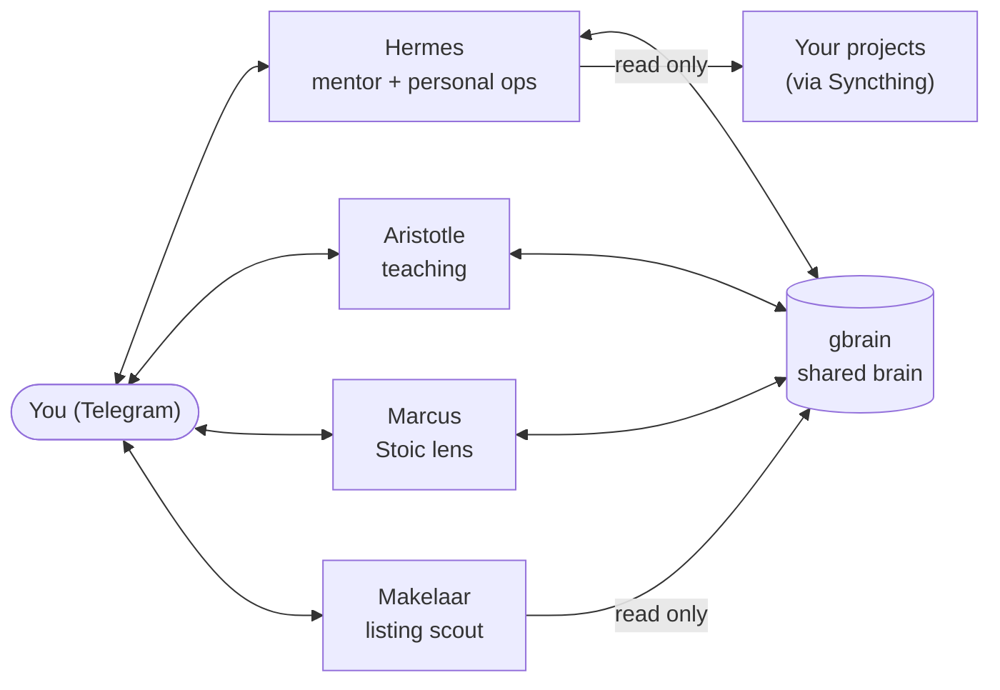

# hermes-fleet

A blueprint for a small fleet of personal AI agents that live in Telegram, share one
second brain, and run on a single locked-down server.

**Status:** this fleet ran from roughly June to August 2026 and has since been
decommissioned. What is here is the working code, personas and skills, cleaned up so you
can rebuild something like it. It is not a hosted product and there is nothing to sign
up for.

## What it looks like

Each agent is its own Telegram bot with its own persona, skills and tools. They share one
long-term memory, and everything runs on one VPS that is reachable only over Tailscale.
The full picture is in [docs/architecture.md](docs/architecture.md).

## The agents

| Agent | What it does | Folder |
| --- | --- | --- |
| Hermes | Mentor and thinking partner. Captures your day, wins, misses and reading into the brain, coaches against your goals, runs a weekly review, reads your calendar and can add or move (never delete) events, sets reminders. | [agents/hermes](agents/hermes/) |
| Aristotle | Private tutor in a Telegram forum group, one topic per learning track. Generates sourced, interactive lessons in the background and serves them on a small lesson site. | [agents/aristotle](agents/aristotle/) |
| Marcus | Answers through a Stoic lens, quoting Marcus Aurelius, Epictetus and Seneca from a public-domain corpus with citations. | [agents/marcus](agents/marcus/) |
| Makelaar | Rental-listing scout. Collects, filters, scam-checks and scores listings and pings the good ones. Never contacts anyone, applies or pays. | [agents/makelaar](agents/makelaar/) |
| Projects bridge | Not an agent: lets Hermes read your laptop projects through a read-only mirror, with one append-only log as its only write. | [bridges/projects](bridges/projects/) |

## What's in each folder

- `agents/<name>/`: one folder per agent. `README.md` (how it works and how to set it
  up), `SOUL.md` (identity and hard rules), `skills/` (procedures the agent follows),
  and `engine/` for any code that runs beside it (MCP servers, cron scripts).
- `agents/makelaar/home_hunt/`: the listing pipeline, a Python package with tests.
- `bridges/projects/`: the read-only projects MCP, its tests, and Syncthing ignore lists.
- `docs/`: [architecture](docs/architecture.md), [security model](docs/security.md)
  and [lessons learned](docs/lessons.md).
- `scripts/scan.sh`: the leak scanner run before every commit to keep personal data
  and secrets out of this repo.
- `AGENTS.md`: instructions for a coding agent helping you rebuild this.

## Start here

- **If you are a person:** read [docs/architecture.md](docs/architecture.md), then the
  README of the agent you care about most. [docs/security.md](docs/security.md) is worth
  reading before you give any agent a tool.
- **If you are a coding agent:** read [AGENTS.md](AGENTS.md) first.

A sensible first build is Hermes alone with the brain. The specialists are independent
and can be added one at a time.

## Not included

- **Content-drafting skills** (social post drafting): too tied to one person's voice
  and to paid scraping APIs to be useful as a template.
- **A video learning bridge** (videos into NotebookLM for Aristotle): it relied on
  automating a consumer Google web app, which is brittle and hard to contain.
- **Site-specific rental scrapers**: check each site's terms yourself; Makelaar ships
  an email-alert source and a scraper template instead.
- **Personal data**: goals, journal pages, preferences, ids and the real brain content
  are all left out. Personas and goal pages are templates to rewrite in your own words.

## Credits

- [Hermes Agent](https://github.com/NousResearch/hermes-agent) by Nous Research: the
  agent framework every bot runs on.
- [gbrain](https://github.com/garrytan/gbrain) by Garry Tan: the shared second brain.
- [mattpocock/skills](https://github.com/mattpocock/skills) by Matt Pocock: the
  `/teach` skill behind Aristotle's lessons, and the `grilling` skill its grill packs
  are adapted from.
- [stoa-brain](https://github.com/ralphvspanje-hub/stoa-brain): the public-domain Stoic
  corpus behind Marcus.

## License

[MIT](LICENSE).

Built by [Ralph van Spanje](https://github.com/ralphvspanje-hub).
