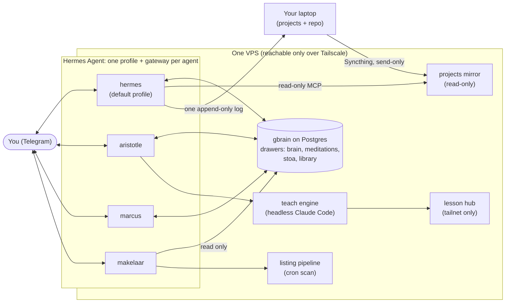

# Architecture

The whole fleet ran on one small Linux VPS. There was no Kubernetes, no queue, no web
app: a handful of long-running processes, a Postgres database, and a few cron entries.
This page explains how those pieces fit together. Each agent's README has the setup
detail.

## The picture

## Hermes Agent: one profile per agent

The agents are built on [Hermes Agent](https://github.com/NousResearch/hermes-agent) by
Nous Research. Hermes has **profiles**: separate configurations that share one install.
Each agent in this repo is one profile with:

- its own Telegram bot token and allowlist,
- its own `SOUL.md` (identity and hard rules) and `skills/` (procedures),
- its own `config.yaml`: model, toolsets, MCP servers,
- its own `.env` (chmod 600) for secrets.

The main agent uses the `default` profile; the specialists are named profiles
(`aristotle`, `marcus`, `makelaar`). Splitting agents into profiles rather than piling
skills onto one bot keeps each persona focused and lets each one have exactly the tools
it needs and no more. See [security.md](security.md) for why that matters.

| Agent | Profile | Folder |
| --- | --- | --- |
| Hermes, mentor and personal ops | `default` | [agents/hermes](../agents/hermes/) |
| Aristotle, teaching | `aristotle` | [agents/aristotle](../agents/aristotle/) |
| Marcus, Stoic lens | `marcus` | [agents/marcus](../agents/marcus/) |
| Makelaar, rental-listing scout | `makelaar` | [agents/makelaar](../agents/makelaar/) |
| Projects bridge (not an agent) | used by `default` | [bridges/projects](../bridges/projects/) |

## Gateways: one Telegram bot per profile

Every profile runs its own gateway, a long-lived process that polls Telegram and feeds
messages to the agent. Each gateway is a **systemd user service**, with
`loginctl enable-linger` set for the service user so the services start at boot and keep
running with nobody logged in. Telegram is polled outbound, so no gateway needs an
inbound port.

Other long-running processes (Aristotle's lesson hub, Syncthing) are systemd user units
in the same way.

## gbrain: the shared brain

[gbrain](https://github.com/garrytan/gbrain) is the long-term memory, served to the
agents as an MCP server over stdio. It stores Markdown pages in Postgres with embeddings
for semantic search.

Pages live in separate **sources**, called drawers here. A query scoped to one drawer
cannot surface pages from another:

| Drawer | Holds | Who uses it |
| --- | --- | --- |
| `brain` (default) | your journal, lessons, wins, goals, concepts, people, projects | Hermes reads and writes; Aristotle saves concept pages; Marcus saves reflections under `stoa/` on request; Makelaar reads only |
| `meditations` | Marcus Aurelius, one passage per page | Marcus searches |
| `stoa` | Epictetus and Seneca | Marcus searches |
| `library` | verbatim full-text keeps of articles, saved only on explicit ask | Hermes, through a second MCP entry scoped to this drawer |

Agents use a small set of tools: search, get a page, put a page. Each profile's MCP
config lists exactly the tools it gets. Makelaar's list has no write tools at all, which
makes it read-only no matter what its prompt says.

Two notes on running it:

- **Postgres, not the embedded database.** With two or more agents each starting their
  own gbrain MCP process, a shared embedded (PGLite) database directory can get
  corrupted. Postgres handles concurrent clients.
- **Embeddings.** The fleet ran on Google's `gemini-embedding` model. gbrain supports
  several providers; pick one and stick with it, because switching models means
  re-embedding every drawer.

## Projects bridge: Syncthing plus a read-only MCP

Hermes can read your laptop's project folders through a Syncthing mirror: send-only on
the laptop, receive-only on the server. A small MCP server exposes read tools over that
mirror and one append-only write: a build log that syncs back to your laptop, where your
coding agent treats each entry as an untrusted request. Details and the trust-boundary
rule: [bridges/projects](../bridges/projects/).

## Network: Tailscale only

The VPS had no public ports open. Admin access, the lesson hub, and Syncthing all ran
over [Tailscale](https://tailscale.com/). Telegram and the model APIs are outbound calls.
If you cannot reach the box over your tailnet, you cannot reach it at all, which is the
point.

## Two layers of scheduling

Scheduled work comes in two kinds, and they use different tools on purpose:

- **System cron, for fixed-text nudges.** Example: the Sunday weekly review. A shell
  script posts a fixed prompt through the Telegram Bot API. No model call, no tools,
  nothing to go wrong. Your reply lands in the normal chat session, where a skill takes
  over. Makelaar's listing scan is also a plain cron job.
- **Hermes native cron jobs, for work that needs the agent.** Example: the weekly model
  check, which searches the web and updates a brain page. It runs as a skill inside the
  agent, on a `cron` toolset that is set explicitly to the same scoped list as the chat
  toolset. Hermes also uses its native cron toolset for reminders you ask for in chat.

Long jobs (a lesson takes minutes of model time) do not run inside a chat turn at all.
They are spawned detached and report back when done; see
[agents/aristotle](../agents/aristotle/).

## What it ran on

These are the versions it was verified on, not requirements:

- Hermes Agent v0.19.1
- gbrain 0.42.x on Postgres
- Claude Sonnet as the default chat model for every profile
- Claude Opus for Aristotle's teach engine
- A small CPU-only VPS; voice notes were transcribed locally on CPU
